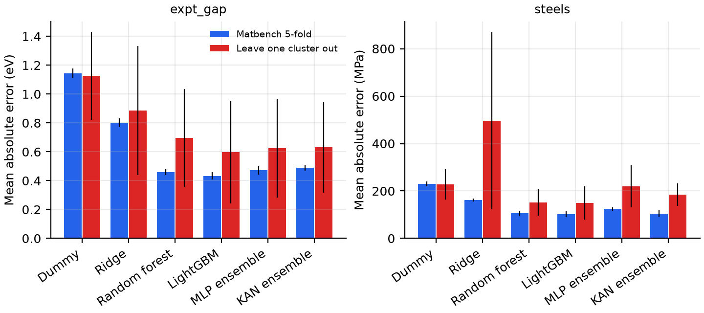
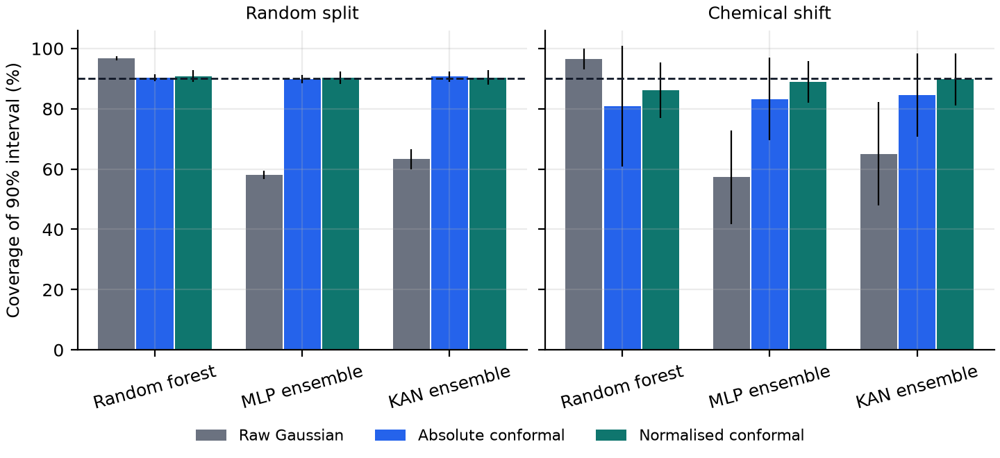
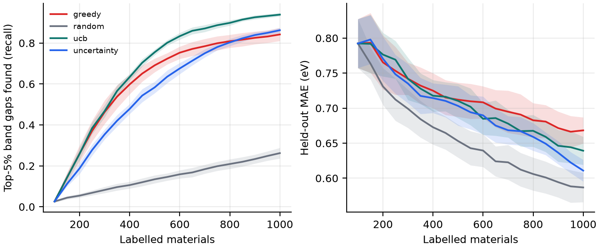
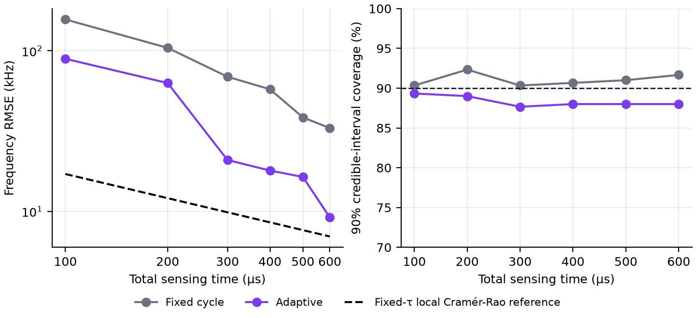

# Trustworthy Materials ML

[](https://github.com/fronzi/trustworthy-materials-ml/actions/workflows/ci.yml)

**When should a scientist trust a model enough to act on it?** This project tests that question on real
materials data, then applies the same decision logic to a simulated quantum sensor.

**Main finding.** A random train-test split makes every learned model look better than it does on
unfamiliar chemistry: MAE rises by a factor of 1.10 to 3.07 under leave-one-cluster-out testing.
Conformal calibration repairs uncertainty on random splits, but not reliably under that shift.



## Results

### Prediction under distribution shift

| Task | Model | Random 5-fold MAE | Leave-one-cluster-out MAE | Ratio |
|---|---|---|---|---|
| expt_gap (eV) | Dummy mean | 1.144 ± 0.035 | 1.126 ± 0.305 | 0.98 |
| expt_gap (eV) | Ridge | 0.802 ± 0.030 | 0.885 ± 0.446 | 1.10 |
| expt_gap (eV) | Random forest | 0.460 ± 0.020 | 0.696 ± 0.339 | 1.51 |
| expt_gap (eV) | LightGBM | 0.433 ± 0.025 | 0.598 ± 0.357 | 1.38 |
| expt_gap (eV) | MLP ensemble | 0.471 ± 0.029 | 0.624 ± 0.343 | 1.32 |
| expt_gap (eV) | KAN ensemble | 0.488 ± 0.020 | 0.630 ± 0.313 | 1.29 |
| steels (MPa) | Dummy mean | 229.7 ± 10.8 | 227.8 ± 63.4 | 0.99 |
| steels (MPa) | Ridge | 161.8 ± 6.4 | 496.5 ± 374.8 | 3.07 |
| steels (MPa) | Random forest | 105.2 ± 12.1 | 152.1 ± 57.1 | 1.45 |
| steels (MPa) | LightGBM | 101.6 ± 12.0 | 149.3 ± 69.8 | 1.47 |
| steels (MPa) | MLP ensemble | 123.7 ± 7.1 | 219.7 ± 88.7 | 1.78 |
| steels (MPa) | KAN ensemble | 104.5 ± 13.6 | 184.6 ± 48.3 | 1.77 |

Error terms are standard deviations across folds. Cluster-out folds have different difficulty, so their spread is large.

**Validation (nothing fitted).** The dummy model reproduces the published Matbench `expt_gap` result:
**1.1435 eV here versus 1.1435 eV on the [leaderboard](https://matbench.materialsproject.org/Leaderboards%20Per-Task/matbench_v0.1_matbench_expt_gap/)**.

**Context.** The best model here is LightGBM at 0.433 eV. That is close to the leaderboard's
RF-SCM/Magpie entry (0.4461 eV) and clearly behind MODNet v0.1.12 (0.3327 eV). This repository
does not claim a state-of-the-art predictor. Its contribution is the evaluation and decision framework.

### Calibrated uncertainty: 90% intervals on `expt_gap`

| Model | Random: raw | Random: conformal | Cluster shift: raw | Cluster shift: conformal |
|---|---|---|---|---|
| Random forest | 96.8% | 90.8% | 96.5% | 86.2% |
| MLP ensemble | 58.1% | 90.3% | 57.3% | 88.9% |
| KAN ensemble | 63.3% | 90.3% | 65.0% | 89.7% |

<p align="center"></p>

### Active learning: finding the top 5% band gaps

After 1,000 labels, UCB found **94%** of the targets and random selection found **26%**
(paired difference 0.68, 95% CI 0.65 to 0.70, 10 seeds). There is a trade-off: every
targeted strategy had a *worse* general test MAE than random sampling.

<p align="center"></p>

### Quantum sensing extension (simulation)

An NV-centre-style Ramsey magnetometer chooses each interrogation time and phase by expected information
gain per unit time. It is compared with a fixed cycle over the same settings, using 300 paired trials.

| Sensing time (µs) | Adaptive / fixed RMSE | 95% bootstrap CI |
|---|---|---|
| 100 | 0.57 | 0.34 to 0.79 |
| 200 | 0.60 | 0.19 to 1.01 |
| 300 | 0.30 | 0.21 to 0.45 |
| 400 | 0.31 | 0.18 to 0.51 |
| 500 | 0.43 | 0.22 to 0.76 |
| 600 | 0.28 | 0.21 to 0.41 |

Adaptive 90% credible intervals covered 87.7% to 89.3% of true values.
At 600 µs the adaptive RMSE is 28% of the fixed-cycle RMSE.
The 200 µs interval includes 1, so that time point alone is inconclusive.

<p align="center"></p>

### Pre-registered hypotheses ([plan](docs/RESEARCH_PLAN.md))

| ID | Outcome | Evidence |
|---|---|---|
| H1: random splits overstate performance | **Supported** | Cluster-out MAE is higher for all learned models in both tasks |
| H2: conformal restores nominal coverage on random splits | **Mostly supported** | Mean gap 1.0 points; the largest, 3.8 points in the small `steels` task, exceeds the 3-point criterion |
| H3: guarantees weaken under chemical shift | **Supported** | Mean coverage gap 7.8 points; largest 29.8 points |
| H4: greedy or UCB finds targets faster than random | **Supported** | UCB interval is entirely above zero; greedy result is in `active_learning_tests.csv` |
| H5: uncertainty sampling lowers test MAE faster | **Rejected** | MAE was higher by 0.024 eV (95% CI 0.013 to 0.035) |
| H6: adaptive sensing lowers error | **Supported at 5 of 6 budgets** | Bootstrap interval excludes a ratio of 1 except at 200 µs |

## Skills demonstrated

| Target role | Essential skills shown here | Highly desirable extensions shown here |
|---|---|---|
| **Applied / AI Research Scientist** | PyTorch, ensembles, experimental design, baselines, hypothesis testing | From-scratch KAN-style layer, conformal prediction, active learning, research under distribution shift |
| **Materials Modelling Scientist** | Composition descriptors, pymatgen, Matbench, property prediction | Chemical-cluster validation, uncertainty for screening, descriptor interpretation |
| **Computational Scientist / Scientific Software Specialist** | Installable package, CLI, tests, typed code, reproducible runs | Property-based tests, analytic and Lindblad cross-checks, parallel experiments, CI |
| **Quantum Technology Scientist** | Spin Hamiltonians, Ramsey sequences, decoherence, QuTiP | Bayesian adaptive sensing, Fisher information, calibration of posterior intervals |
| **R&D Scientist / Research Manager** | Decision framing, milestones, risks, transparent reporting | [Research plan](docs/RESEARCH_PLAN.md), [decision log](docs/DECISIONS.md), negative results kept in view |
| **Machine Learning Engineer** | Modular pipelines, deterministic seeds, automated checks | Cached artefacts, run manifest, model-agnostic uncertainty interface |

## Method notes

- **Features:** 60 transparent descriptors from elemental properties and stoichiometry.
- **Splits:** official Matbench 5-fold seed, plus five K-means chemistry clusters held out in turn.
- **Uncertainty:** forest and ensemble spread, Gaussian intervals, absolute and normalised split conformal prediction.
- **KAN:** a compact Gaussian-basis Kolmogorov-Arnold-style network. Top descriptors by edge magnitude are `n_elements`, `valence_p_mean`, `group_mean`. They are model associations, not causal mechanisms.
- **Quantum checks:** analytic Ramsey signal against a QuTiP Lindblad solution, and aligned-field NV transitions against `D ± γB`.

## Run it

```bash
make install
make test
.venv/bin/trustmat all --jobs 4   # downloads public data and reproduces all results
```

## Assumptions and limits

- Composition-only models cannot distinguish polymorphs.
- Leave-one-cluster-out depends on the chosen clustering and has only five folds.
- Active learning is retrospective, so "experiments" reveal labels already in the dataset.
- The quantum study is a **simulation** with assumed T2* = 10 µs, visibility 0.8 and 2 µs overhead.
  It omits hyperfine structure, drift, pulse errors, spin-bath memory and hardware validation.
- The Cramér-Rao curve is a local reference for repeated fixed-time Ramsey, not a universal bound.

**What would change the conclusions:** structure-aware models, alternative chemistry groupings, prospective
measurements, and experimental NV data with a realistic noise model.

## References

- Dunn et al., *npj Computational Materials* (2020), [10.1038/s41524-020-00406-3](https://doi.org/10.1038/s41524-020-00406-3). Matbench.
- Zhuo et al., *J. Phys. Chem. Lett.* (2018), [10.1021/acs.jpclett.8b00124](https://doi.org/10.1021/acs.jpclett.8b00124). Band-gap data.
- Ward et al., *npj Computational Materials* (2016), [10.1038/npjcompumats.2016.28](https://doi.org/10.1038/npjcompumats.2016.28). Composition features.
- Meredig et al., *Mol. Syst. Des. Eng.* (2018), [10.1039/C8ME00012C](https://doi.org/10.1039/C8ME00012C). Cluster-based validation.
- Romano et al. (2019), [arXiv:1905.03222](https://arxiv.org/abs/1905.03222). Conformalised quantile regression.
- Lakshminarayanan et al. (2016), [arXiv:1612.01474](https://arxiv.org/abs/1612.01474). Deep ensembles.
- Liu et al. (2024), [arXiv:2404.19756](https://arxiv.org/abs/2404.19756). KAN.
- Doherty et al., *Physics Reports* (2013), [10.1016/j.physrep.2013.02.001](https://doi.org/10.1016/j.physrep.2013.02.001). NV centre.
- Degen et al., *Rev. Mod. Phys.* (2017), [10.1103/RevModPhys.89.035002](https://doi.org/10.1103/RevModPhys.89.035002). Quantum sensing.

Companion project: [nem-battery-lab](https://github.com/fronzi/nem-battery-lab).
Developed with AI coding assistance. Licensed under MIT.
